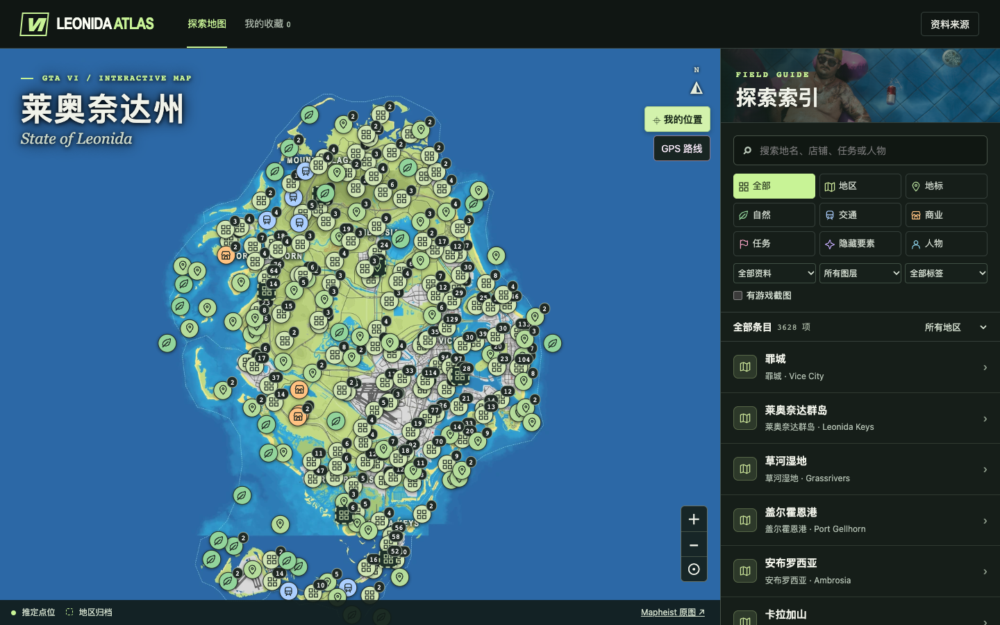
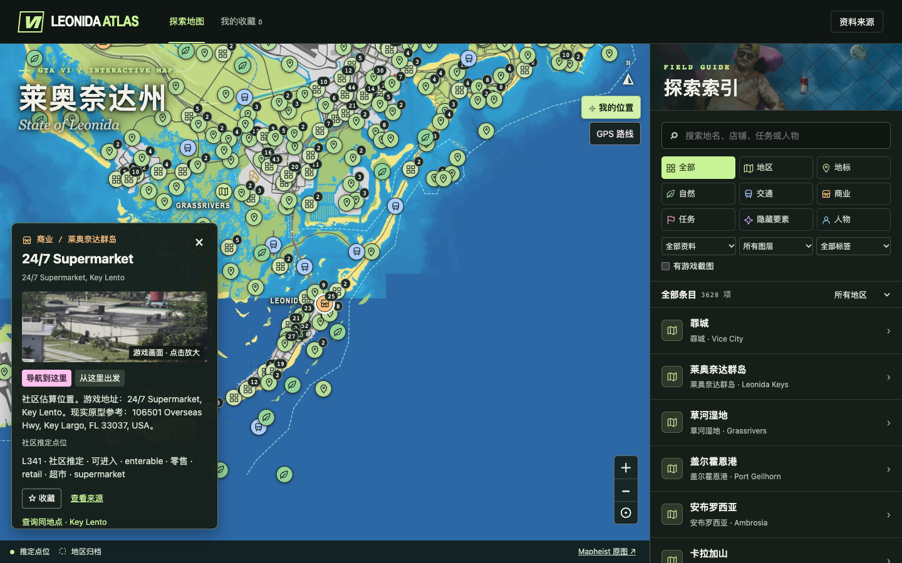
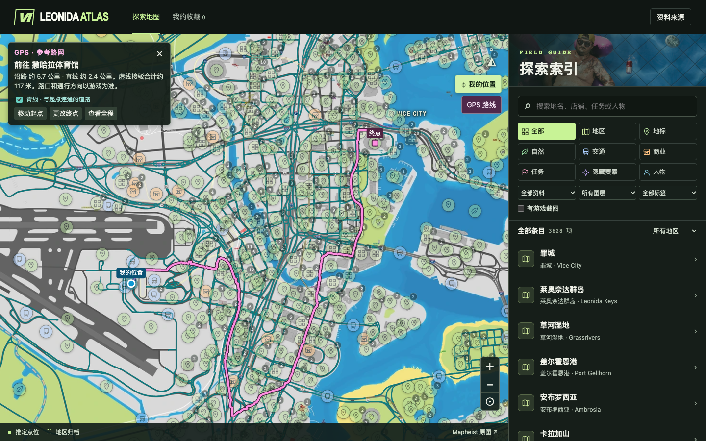

# GTA 6 Map Guide · Leonida Atlas

[中文指南](README.md) · [Open the map](https://leonida-atlas-jh-261119.jerryhubrit.chatgpt.site) · [Download the offline edition](https://github.com/jerryhubrit/gta-6-map-guide/releases/latest)

Keep this map open while you explore Leonida. Look up shops, missions, secrets and characters, compare a location with an in-game screenshot, or drop a pin to see what is nearby. The interface is in Chinese and accepts English place names.

## Find your way around

| To do this | Use these controls |
| --- | --- |
| Find a place | Enter an English or Chinese name in the search box. Filter by category, region or tag, then open a result. |
| Compare a scene | Select **有游戏截图** (has a game screenshot). Click the preview to enlarge it. Try the [24/7 Supermarket in Key Lento](https://leonida-atlas-jh-261119.jerryhubrit.chatgpt.site/?poi=L341). |
| See what is nearby | Click **我的位置** (my position), then click your spot on the map. The list sorts places by straight-line distance within 300 m, 1 km or 3 km. |
| Plan a drive | Open a destination and click **导航到这里** (route here). For a custom destination, open **GPS 路线** and click **地图选终点**. |
| Save a place | Click **收藏** on its card. Find it again under **我的收藏** (favorites) in the same browser. |

## Try a route

Open [Vice City Airport](https://leonida-atlas-jh-261119.jerryhubrit.chatgpt.site/?poi=place-mia-airport) and click **从这里出发** (start here). Then open [Sahara Arena](https://leonida-atlas-jh-261119.jerryhubrit.chatgpt.site/?poi=place-kaseya) and click **导航到这里**. The mapped drive is about 5.7 km.

The pink line follows the mapped roads. Dashed sections show the straight-line gap from each pin to the road. With a start point set, the teal overlay highlights connected roads. Coverage is partial, and one-way streets and interchange turns still need in-game verification. Character locations can change with the story. Each card identifies locations known only at region level.

## Run offline

- **Player download.** Get `gta-6-map-guide-offline.zip` from Releases, extract the entire folder and open `GTA6-Atlas/index.html`. It includes map tiles, the place index, the road network and 1,348 full-size game images. No installation is needed.
- **Source checkout.** Clone this repository or extract GitHub’s Source code ZIP, then open [dist/index.html](dist/index.html). Tiles, routing and screenshot previews work offline. In this edition, full-size images load from the upstream image archive.

This version includes 3,628 entries and map detail up to 19,000 × 19,000 pixels. You place your position marker manually. Your position and favorites are stored in the browser.

## Credits

- The YANIS v16 map and location catalogue are credited to GTADB and its community contributors. Source tiles were cropped, re-tiled and compressed to WebP. Road centerlines were extracted from the map, with selected downtown and cross-bay sections reviewed against the source imagery. [GTADB](https://github.com/rolux/gtadb.org) · [Pinned tile archive](https://github.com/navanem/gta6-leonida-atlas/tree/0c7434f5bd5ed59a58aaa75a3ba7c3734fa0c4d0/public/assets/street-leonida/maps/gtadb-yanis-16-z5) · [CC BY 4.0](https://creativecommons.org/licenses/by/4.0/)
- Mapheist supplies additional place coordinates, evidence and real-world matches. Its records were translated and categorized for the Chinese interface. Individual place cards link to their sources. [Mapheist open data](https://mapheist.com/en/data/) · [CC BY 4.0](https://creativecommons.org/licenses/by/4.0/)
- Game imagery comes from the GTADB image archive. Game artwork and trademarks belong to Rockstar Games and their respective owners. This is an unofficial player guide. [Image archive](https://github.com/rolux/gtadb.org/tree/5c1d69ff864623d181da5457afaacd00b623e1a4/map/photos/6)
