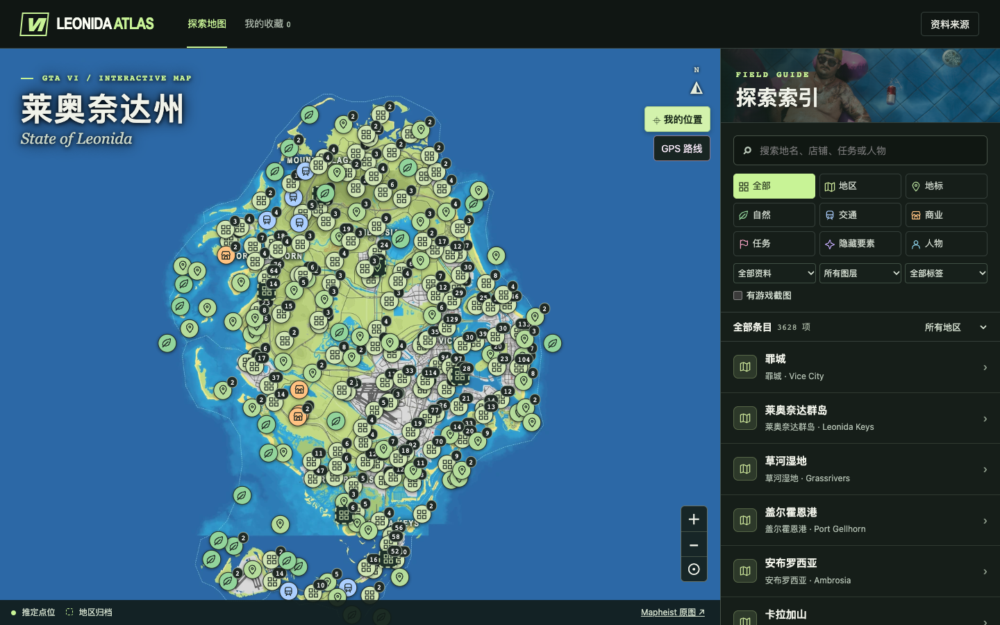
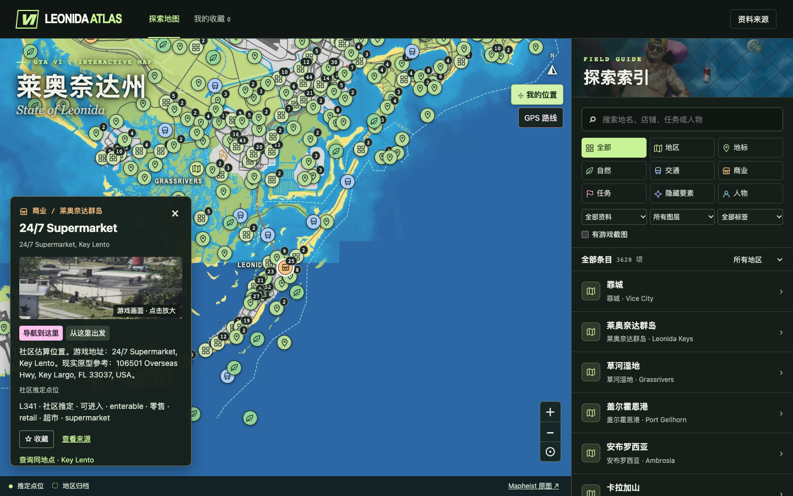
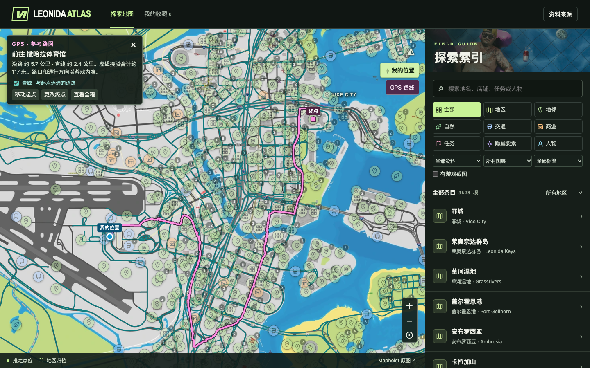

# GTA 6 Map Guide · 莱奥奈达地图指南

[English guide](README.en.md) · [打开在线地图](https://leonida-atlas-jh-261119.jerryhubrit.chatgpt.site) · [下载离线版](https://github.com/jerryhubrit/gta-6-map-guide/releases/latest)

一份玩《GTA VI》时可以随手查的中文地图。搜索地名、店铺、任务、隐藏要素或人物，查看对应的游戏画面，也可以标出自己所在的位置，找附近值得去的地方。

## 第一次使用

| 你想做什么 | 在地图上怎么操作 |
| --- | --- |
| 找一家店或一个任务 | 在搜索框输入中文名或英文名。用类别、地区或标签缩小范围，点结果查看详情。 |
| 用游戏画面对位置 | 勾选「有游戏截图」。打开地点，点击预览图放大。例如 [Key Lento 的 24/7 Supermarket](https://leonida-atlas-jh-261119.jerryhubrit.chatgpt.site/?poi=L341)。 |
| 看自己附近有什么 | 点「我的位置」，再点你在游戏里所在的位置。列表按直线距离排序，可切换 300 米、1 公里或 3 公里范围。 |
| 规划路线 | 打开目的地详情，点「导航到这里」。也可以点「GPS 路线」手动选终点。 |
| 记住想去的地方 | 在详情中点「收藏」，下次用同一浏览器打开「我的收藏」即可查看。 |

## 跟着走一条路线

打开[罪城机场](https://leonida-atlas-jh-261119.jerryhubrit.chatgpt.site/?poi=place-mia-airport)，点「从这里出发」。再打开[撒哈拉体育馆](https://leonida-atlas-jh-261119.jerryhubrit.chatgpt.site/?poi=place-kaseya)，点「导航到这里」。这个例子沿路约 5.7 公里。

粉色实线是规划路线，虚线是标记到路段的直线间隔。勾选青线路网后，可以看到与起点连通的道路。部分区域还存在断点，单行道和立交转向需在游戏中核对。人物位置可能随剧情变化。仅知道所属地区的条目会在详情中说明定位精度。

## 离线使用

- **给朋友直接用**　从 Releases 下载 `gta-6-map-guide-offline.zip`，完整解压，打开 `GTA6-Atlas/index.html`。包内包含高清底图、点位、GPS 路网及 1,348 张游戏画面的原图，无需安装。
- **从源码运行**　克隆仓库或下载 GitHub 的 Source code ZIP，打开 [dist/index.html](dist/index.html)。地图、路线和截图预览均可离线使用；此版本打开截图原图时会访问上游图片库。

网站界面为中文，可以用英文地名检索。当前版本收录 3,628 条资料，最高缩放层为 19,000 × 19,000 像素。我的位置由玩家手动标记，收藏和位置保存在当前浏览器。

## 地图与图片来源

- YANIS v16 底图和地点目录来自 GTADB 及社区制图者，原始切片经坐标裁切、WebP 压缩和分级处理。本站从道路图层提取中心线，并复核了部分市区和跨湾路段。[GTADB](https://github.com/rolux/gtadb.org) · [切片存档](https://github.com/navanem/gta6-leonida-atlas/tree/0c7434f5bd5ed59a58aaa75a3ba7c3734fa0c4d0/public/assets/street-leonida/maps/gtadb-yanis-16-z5) · [CC BY 4.0](https://creativecommons.org/licenses/by/4.0/)
- 部分地点坐标、证据和原型资料来自 Mapheist，经过中文翻译和分类。每个地点的详情提供对应来源。[Mapheist 开放数据](https://mapheist.com/en/data/) · [CC BY 4.0](https://creativecommons.org/licenses/by/4.0/)
- 游戏画面来自 GTADB 公开图片目录，游戏画面及相关商标归 Rockstar Games 等权利人所有。本项目是非官方玩家指南。[游戏图片目录](https://github.com/rolux/gtadb.org/tree/5c1d69ff864623d181da5457afaacd00b623e1a4/map/photos/6)
